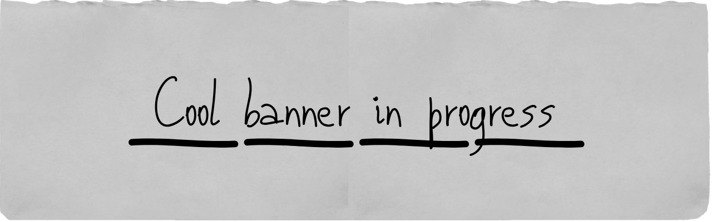

### Hi there 👋, my name is Adrián
#### I am a Neuroscience Graduate

I am developing my computational skills in neuroscience by reproducing research project using publicly available datasets.

Languages:  

Libraries: NumPy 	  

- 📫 How to reach me: adrian122014@gmail.com
